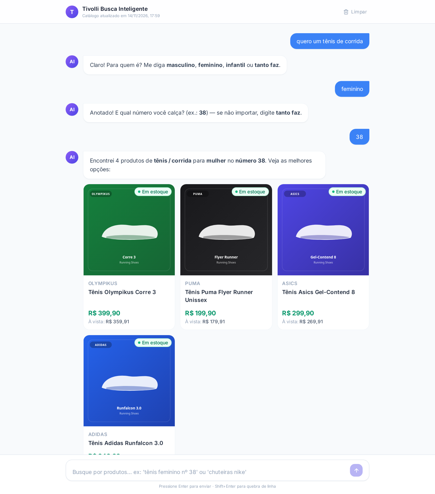
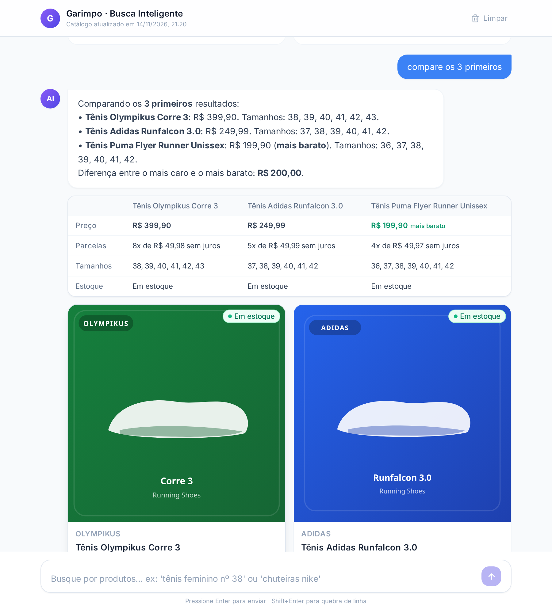
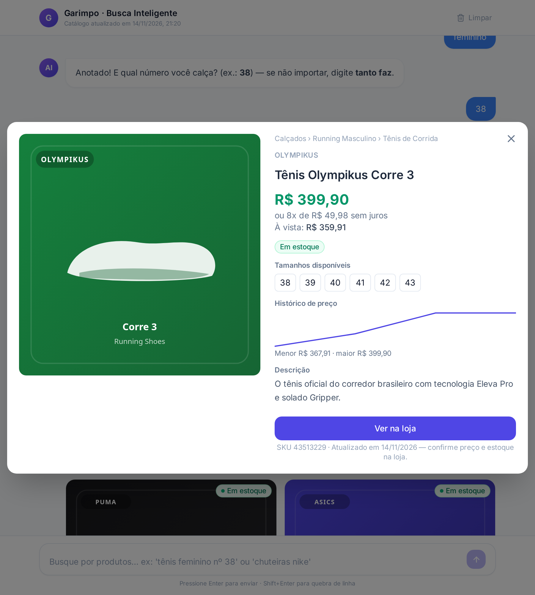

# Garimpo

Catalog scraper, REST API and conversational product search.

[](https://github.com/EttoreCSenatore/garimpo/actions/workflows/ci.yml)
[](https://github.com/EttoreCSenatore/garimpo/actions/workflows/codeql.yml)
[](LICENSE)

📖 **Documentation (English · Português):** https://ettorecsenatore.github.io/garimpo/

*Garimpo* is Brazilian Portuguese for prospecting; *garimpar* is what you do when you hunt for a good find or a bargain. The project keeps a fresh copy of an online store's catalog and lets people dig through it in plain language.

It is a rate-limited catalog scraper, FastAPI REST API and conversational search (React) for the Brazilian sports e-commerce site **tivolli.com.br** (Tivolli Sports, the store), with structured JSON event logs.



| Compare products | Price history |
| --- | --- |
|  |  |

> Screenshots use generic demo data (`python -m app.seed`), not the store's real catalog.

> **Responsible use:** this software scrapes publicly available catalog data from tivolli.com.br. You **must have permission** to scrape the site before running it, and respect its `robots.txt` and terms of service. No personal data is collected. The disallowed paths `/tivadm43` and `/homologacao` are blocked in code. See [Responsible use](https://ettorecsenatore.github.io/garimpo/responsible-use).

## Features

- **Scraper**: categories from `google_sitemap.xml`, paginated listings (`/{category}?p=N`), product pages on the store's Magento platform (JSON-LD, price, cash price, installments, sizes, stock, full image gallery, breadcrumbs)
- **Polite by design**: one process-wide budget of ~1 request/second with 500–1500 ms jitter and exponential back-off; same-site URLs only
- **Freshness**: full refresh every 6 h, the 200 most viewed products every 15 min, and a background refresh when a product older than 5 min is viewed
- **REST API**: FastAPI with OpenAPI docs, cursor pagination, filters, price history and HTTP cache headers
- **Full-text search**: SQLite FTS5 over name, brand, category and slug; accent- and order-insensitive, prefix matching, BM25 ranking
- **Chat search**: a rule-based intent parser (Portuguese and English, no LLM or API keys) that asks for gender and shoe size when needed, then answers follow-ups from the database: compare products, cheapest in stock, price history
- **Price history**: every real price change is recorded and drawn as a chart in the product view
- **Scraper canary**: a weekly live check that fails when the store's markup changes
- **Structured events**: scrape runs, price changes and errors as JSON logs, ready for any log collector
- **Secure defaults**: SSRF-safe image proxy, admin token required in production, strict CORS, rate limits, non-root read-only container

## Try it in one command

Demo data, no scraping, throwaway database (needs Python 3.12+ and Node.js):

```bash
./scripts/demo.sh
```

Open http://localhost:5173 and try *tênis de corrida*, answer the two questions, then press **Comparar os 3 primeiros**. How the design hangs together: [How it works](https://ettorecsenatore.github.io/garimpo/how-it-works).

## Quick start

Requires Python 3.12+ (and Node.js 20.19+ or 22.12+ for the frontend).

```bash
python -m venv .venv
.venv/bin/pip install -r requirements.txt
cp .env.example .env

# Explore with demo data and no scraping:
export SCHEDULER_ENABLED=false
.venv/bin/python -m app.seed
.venv/bin/python -m uvicorn app.main:app --reload --port 8000
```

- API: http://127.0.0.1:8000 · interactive docs: http://127.0.0.1:8000/docs
- With `SCHEDULER_ENABLED=true` (the default) a full scrape starts about one minute after startup.

Chat frontend (proxies `/api` to port 8000):

```bash
cd frontend
npm ci
npm run dev        # http://localhost:5173
```

## Run with Docker

```bash
export ADMIN_TOKEN=$(openssl rand -hex 32)   # required; compose refuses to start without it
docker compose up --build
```

The port is published on `127.0.0.1:8000` only; put a TLS reverse proxy in front for public access. See [Deployment](https://ettorecsenatore.github.io/garimpo/deployment).

## Configuration

All settings are in [.env.example](.env.example) and documented in [Configuration](https://ettorecsenatore.github.io/garimpo/configuration). The most important:

| Variable | Default | Description |
|---|---|---|
| `ADMIN_TOKEN` | *(empty)* | Empty disables `/admin/*`; must be 24+ random characters when `APP_ENV=production` |
| `SCHEDULER_ENABLED` | `true` | Set `false` to disable background scraping |
| `USER_AGENT` | `GarimpoBot/1.0 (+repo URL)` | Identify your crawler and a way to contact you |
| `REQUESTS_PER_SECOND` | `1` | Process-wide request budget |
| `CORS_ORIGINS` | `http://localhost:5173,...` | Browser origins allowed to call the API |
| `DATABASE_URL` | `sqlite:///./garimpo.db` | Any SQLAlchemy URL |
| `DISCLAIMER` | `false` | Mark prices as indicative and add `source_url` |

## API

| Method | Path | Description |
|---|---|---|
| `GET` | `/api/health` (also `/`, `/api/`) | Health and time of the last completed refresh |
| `GET` | `/products` | List products: `category_id`, `brand`, `min_price`, `max_price`, `available`, `q`, `cursor`, `limit` |
| `GET` | `/products/{id}` | One product (queues a refresh if the data is older than 5 min) |
| `GET` | `/products/{id}/history` | Price and stock history |
| `GET` | `/categories` | Categories with product counts |
| `GET` | `/stats` | Totals and 24 h success rate |
| `POST` | `/api/chat` | Conversational search |
| `GET` | `/api/image-proxy?url=` | Product images from allow-listed hosts |
| `POST` | `/admin/refresh` | Start a full refresh (header `X-Admin-Token`) |
| `POST` | `/admin/refresh/{id}` | Refresh one product |
| `GET` | `/admin/queue` | Active workers, in-flight refreshes, chat sessions |

```bash
curl "http://127.0.0.1:8000/products?brand=Nike&max_price=500&available=true&limit=10"
curl -X POST http://127.0.0.1:8000/api/chat -H 'Content-Type: application/json' \
  -d '{"message": "tênis feminino número 38", "session_id": "demo-1"}'
curl -X POST http://127.0.0.1:8000/admin/refresh -H "X-Admin-Token: $ADMIN_TOKEN"
```

Chat replies are in Portuguese, for example:

```json
{
  "reply": "Encontrei 4 produtos de **tênis** para **mulher** no **número 38**. Veja as melhores opções:",
  "filters_applied": { "category": ["tenis"], "gender": "feminino", "size": 38 },
  "products": [ ... ]
}
```

More in [REST API](https://ettorecsenatore.github.io/garimpo/api) and [Chat search](https://ettorecsenatore.github.io/garimpo/chat-search).

## Logs and events

Everything is logged as JSON lines on stdout (`docker logs`, or any collector). Domain events use the `garimpo.*` names as the log message, for example:

```json
{"event": "garimpo.run.completed", "run_id": 26, "products_scraped": 412, "products_failed": 3, "timestamp": "2026-11-14T21:00:00Z"}
```

Event names: `garimpo.run.started|completed`, `garimpo.product.scraped|updated|disappeared`, `garimpo.error.parse|http`.

## Project structure

```text
app/
  main.py            FastAPI app, lifespan, scheduler, CORS, security headers
  config.py          Settings from environment / .env (fails fast on unsafe production config)
  security.py        Token check, URL allow-listing, rate limiter, security headers
  state.py           Process-wide runtime state and background tasks
  db.py, models.py   SQLModel engine (SQLite WAL), indexes, tables
  tasks.py           Full / incremental / single refresh jobs
  events.py          Structured domain events (JSON logs)
  seed.py            Demo data (python -m app.seed)
  scraper/           Rate-limited client, categories, listings, product parser
  search/            Intent parser for the chat, FTS5 index and ranking
  api/               Routes and dependencies
frontend/            React + Vite + TypeScript + Tailwind chat UI
tests/               pytest suite (HTTP mocked, temporary database, no network)
website/             Docusaurus documentation (English + Brazilian Portuguese)
```

## Development

```bash
.venv/bin/pip install --require-hashes -r requirements-dev.txt
ruff check . && ruff format --check .
.venv/bin/python -m pytest tests -q --cov=app
cd frontend && npx tsc --noEmit && npm run build
```

Dependencies are hash-locked (`deploy/lock.sh`) and GitHub Actions are pinned to commit SHAs. CI runs these plus `pip-audit`, `npm audit`, a lock freshness check and a Docker build; CodeQL scans every pull request. See [CONTRIBUTING.md](CONTRIBUTING.md). Tests never hit the real site and never touch your local `garimpo.db`.

## Security and license

- Found a vulnerability? See [SECURITY.md](SECURITY.md) (private advisory form).
- Licensed under the [MIT License](LICENSE).
