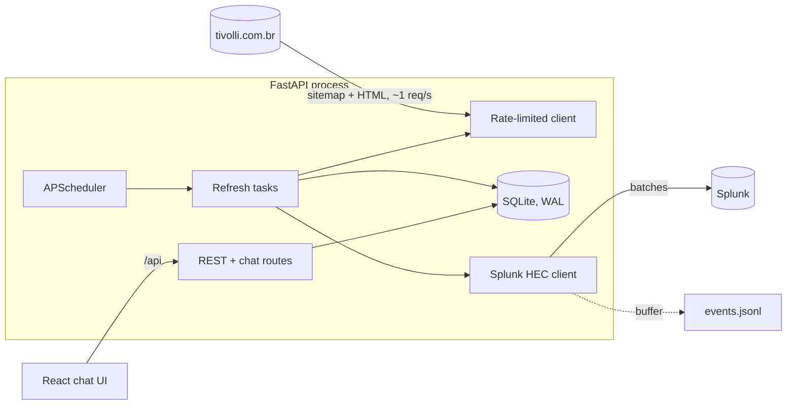

# Architecture

## Modules

| Path | Responsibility |
| --- | --- |
| `app/main.py` | App factory, lifespan, scheduler, CORS and security headers. |
| `app/config.py` | Typed settings from environment / `.env`; fails fast on unsafe production config. |
| `app/api/routes.py` | Public REST API, admin endpoints, image proxy, chat endpoint. |
| `app/search/intent_parser.py` | Rule-based natural-language understanding (PT-BR + EN). |
| `app/search/fts.py` | SQLite FTS5 index (`products_fts`, kept in sync by triggers) and BM25-ranked matching. |
| `app/scraper/*` | Rate-limited HTTP client, sitemap/category discovery, listing crawler, product parser. |
| `app/tasks.py` | Full, incremental and single-product refresh jobs; persistence and history. |
| `app/splunk_hec.py` | Batched Splunk HEC client with an on-disk fallback buffer. |
| `app/security.py` | Token comparison, URL allow-listing, rate limiter, security headers. |
| `app/state.py` | Process-wide runtime state and background-task bookkeeping. |

## Data model

- **Product**: id, slug, url, name, brand, price, boleto price, installments, sizes, availability, images, breadcrumbs, status, view count.
- **ProductHistory**: one row each time price, boleto price, availability or status *changes*.
- **Category** and **ScrapeRun** (type, counts, status) for observability.

## Refresh strategy

| Job | When | What |
| --- | --- | --- |
| Full | every 6 h (and on demand) | Discover categories, crawl every listing, re-fetch every product. |
| Incremental | every 15 min | Re-fetch the 200 most viewed products. |
| Single | on demand | Refresh one product (also queued when a stale product is viewed). |

Full and incremental runs share a lock, so two crawlers never run at once, and all clients share one request budget.
Product views drive the incremental ranking, so popular products stay fresh.

## Design decisions

- **SQLite in WAL mode**: zero-ops and plenty for a single-node catalog. Swapping `DATABASE_URL` to another SQLAlchemy URL is the migration path.
- **Rule-based chat**: instant, free, deterministic and testable; no external model or key.
- **Scrape only what you need**: listings are discovered from the sitemap, never by brute force.
