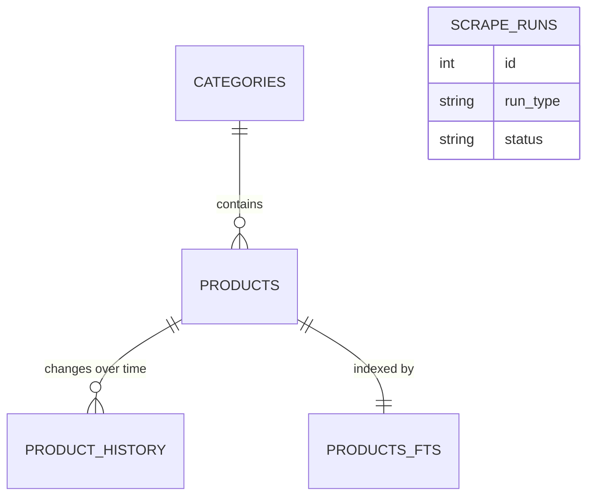

# Data model

SQLite (WAL) through SQLModel. Defined in `app/models.py`; the full-text index lives in `app/search/fts.py`.

| Table | Holds | Notes |
| --- | --- | --- |
| `categories` | Store categories discovered from the sitemap | `id` is a stable CRC32 of the category path (the store exposes no numeric id) |
| `products` | The current state of each product | price, cash price, instalments (JSON), sizes (JSON), stock, images (JSON), breadcrumbs, brand, status, view count |
| `product_history` | One row per **real change** of price, cash price, availability or status | Feeds the price chart and the chat's history answer |
| `parse_failures` | The newest pages that failed to parse, with the start of their HTML | Kept for debugging a store redesign; only the newest `PARSE_FAILURE_SAMPLES_KEEP` (50) stay |
| `watches` | A shopper's alert on a product (size and target price optional) | Keyed by a random browser id, no personal data; destination is an ntfy topic or an allow-listed webhook URL; `baseline_price` and `last_available` track what was already notified |
| `scrape_runs` | Every full, incremental or single refresh | type, counts of scraped, failed and disappeared products, status, error |
| `products_fts` | SQLite FTS5 index over name, brand, breadcrumbs and slug | BM25 ranking; descriptions are excluded on purpose |

Product status is `active`, `out_of_stock` or `disappeared`. A product is marked disappeared when its page returns 404, **or** when it is missing from the listings of `DISAPPEAR_AFTER_CRAWLS` (3) consecutive full crawls (`products.missing_crawls` counts them). A crawl that finds fewer than `DISAPPEAR_MIN_RATIO` (50 %) of the known products is treated as broken and changes nothing, so an outage never empties the catalog. A reappearing product becomes active again.

The schema is managed by [Alembic](./development#database-migrations) migrations: `0001` is the baseline (the 0.4.0 schema) and `0002` adds `missing_crawls` and `parse_failures`, `0003` adds `watches`.
