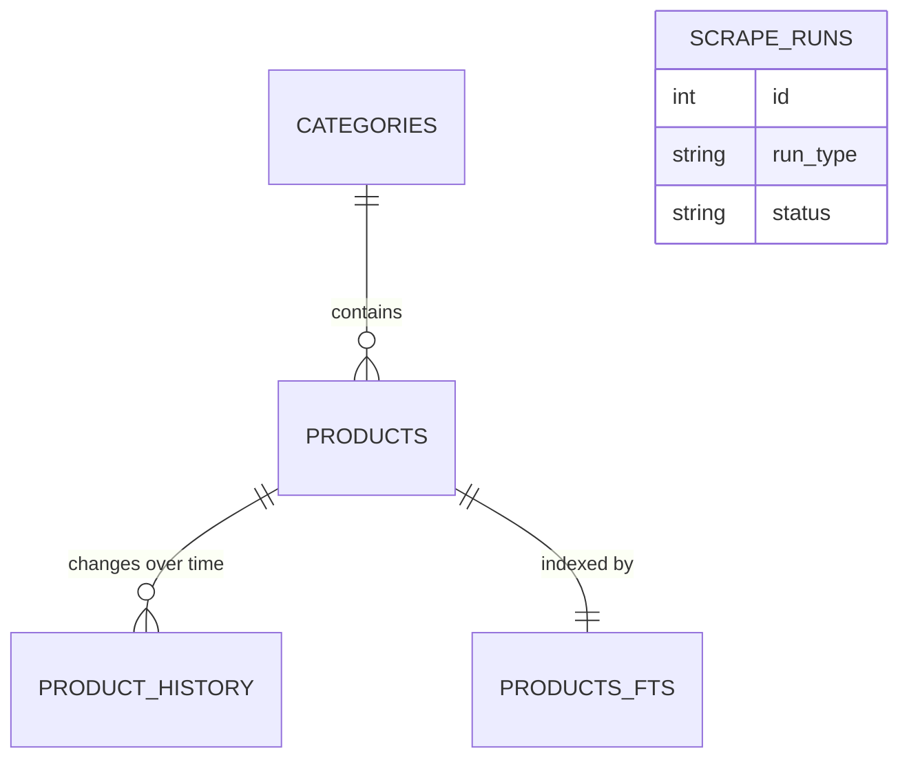

# Data model

SQLite (WAL) through SQLModel. Defined in `app/models.py`; the full-text index lives in `app/search/fts.py`.

| Table | Holds | Notes |
| --- | --- | --- |
| `categories` | Store categories discovered from the sitemap | `id` is a stable CRC32 of the category path (the store exposes no numeric id) |
| `products` | The current state of each product | price, cash price, instalments (JSON), sizes (JSON), stock, images (JSON), breadcrumbs, brand, status, view count |
| `product_history` | One row per **real change** of price, cash price, availability or status | Feeds the price chart and the chat's history answer |
| `scrape_runs` | Every full, incremental or single refresh | type, counts of scraped, failed and disappeared products, status, error |
| `products_fts` | SQLite FTS5 index over name, brand, breadcrumbs and slug | BM25 ranking; descriptions are excluded on purpose |

Product status is `active`, `out_of_stock` or `disappeared`. A product is marked disappeared when its page returns 404.
