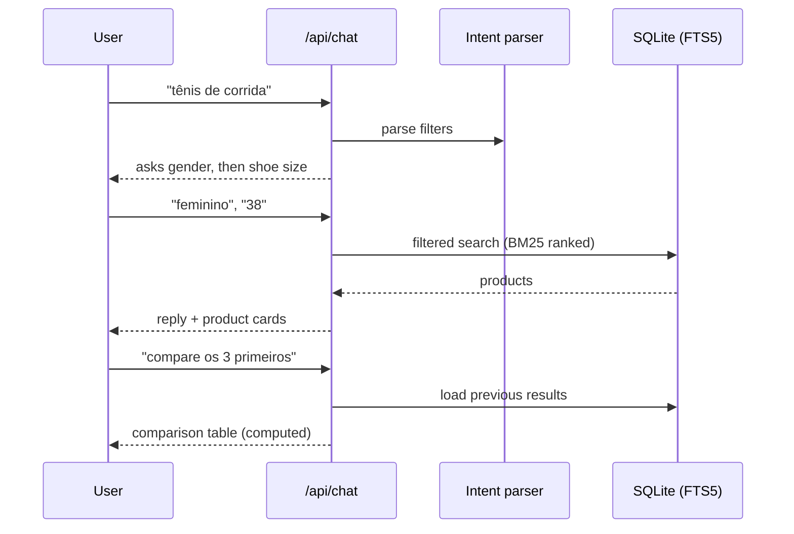

# How it works

The decisions that shape Garimpo, and why.

## A chat that cannot make things up

The chat is rule-based on purpose. A parser turns Portuguese or English into filters, the database answers, and the reply is assembled from rows. Follow-ups such as *compare*, *cheapest* and *price history* run on the products the last answer showed.

Every number the user sees is a database value. There is no model to hallucinate a price, and no API key or per-message cost.

## How the scraper stays polite

- **One budget for the whole process**: about 1 request per second with 500 to 1500 ms of jitter, shared by every job, so a full refresh and a manual refresh never double the load.
- **robots.txt mirrored in code**: blocked paths and query parameters raise an error before any request is made.
- **Honest identity**: a `GarimpoBot` user agent with a link to the repository.
- **Back-off**: 429 and 5xx responses are retried with exponential delay, then given up.
- **Same-site only**: links to other hosts are never followed, and the image proxy has an exact host allow-list.
- **Canary**: a weekly check makes about four requests to notice markup changes early.

## Freshness without hammering

A full crawl every 6 hours, the 200 most viewed products every 15 minutes, and a background refresh when someone opens a product older than 5 minutes. Price history is written only when a tracked field changes, so the history table stays small and every row is a real change.

## Security posture

The scraped HTML and the user's chat messages are both untrusted input.

- Image proxy: exact host allow-list, no IP literals, size cap, content sniffing, and every redirect hop re-checked against the allow-list.
- Admin endpoints are disabled without a token and refuse weak tokens in production.
- Rate limits on chat and images, bounded in-memory sessions, strict CORS, security headers.
- React renders replies as text; links and image URLs must be plain `http(s)`.
- Non-root, read-only container. CodeQL and grouped Dependabot updates run in CI.

Details are in [Security](./security).

## Observability

Scrape runs, product changes and errors are structured JSON events on stdout (`garimpo.run.completed`, `garimpo.product.updated`, `garimpo.error.parse`), so any log collector can use them without agents or vendor lock-in.
