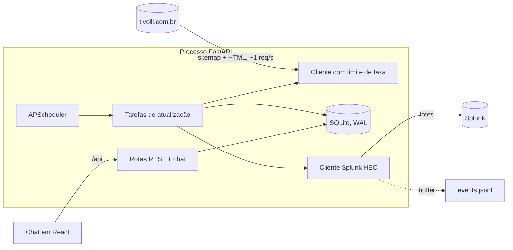

# Arquitetura

## Módulos

| Caminho | Responsabilidade |
| --- | --- |
| `app/main.py` | Criação do app, ciclo de vida, agendador, CORS e cabeçalhos de segurança. |
| `app/config.py` | Configurações tipadas via ambiente / `.env`; falha cedo em configuração insegura de produção. |
| `app/api/routes.py` | API REST pública, endpoints de admin, proxy de imagens e endpoint de chat. |
| `app/search/intent_parser.py` | Compreensão de linguagem natural baseada em regras (PT-BR + EN). |
| `app/scraper/*` | Cliente HTTP com limite de taxa, descoberta de categorias, rastreador de listagens e parser de produto. |
| `app/tasks.py` | Tarefas de atualização completa, incremental e por produto; persistência e histórico. |
| `app/splunk_hec.py` | Cliente Splunk HEC em lotes com buffer de contingência em disco. |
| `app/security.py` | Comparação de tokens, lista de URLs permitidas, limitador de taxa, cabeçalhos de segurança. |
| `app/state.py` | Estado de execução do processo e controle de tarefas em segundo plano. |

## Modelo de dados

- **Product**: id, slug, url, nome, marca, preço, preço no boleto, parcelamento, tamanhos, disponibilidade, imagens, breadcrumbs, status, contagem de visualizações.
- **ProductHistory**: uma linha sempre que preço, preço no boleto, disponibilidade ou status *mudam*.
- **Category** e **ScrapeRun** (tipo, contagens, status) para observabilidade.

## Estratégia de atualização

| Tarefa | Quando | O que faz |
| --- | --- | --- |
| Completa | a cada 6 h (e sob demanda) | Descobre categorias, percorre todas as listagens e busca de novo cada produto. |
| Incremental | a cada 15 min | Atualiza os 200 produtos mais visualizados. |
| Individual | sob demanda | Atualiza um produto (também enfileirada quando um produto desatualizado é visto). |

As execuções completa e incremental compartilham um lock, então dois rastreadores nunca rodam ao mesmo tempo, e todos os clientes dividem um único orçamento de requisições.
As visualizações definem o ranking da atualização incremental, mantendo os produtos populares sempre frescos.

## Decisões de projeto

- **SQLite em modo WAL**: zero operação e mais que suficiente para um catálogo em um único nó. Trocar `DATABASE_URL` por outra URL do SQLAlchemy é o caminho de migração.
- **Chat baseado em regras**: instantâneo, gratuito, determinístico e testável; sem modelo ou chave externa.
- **Coletar só o necessário**: as listagens são descobertas pelo sitemap, nunca por força bruta.
