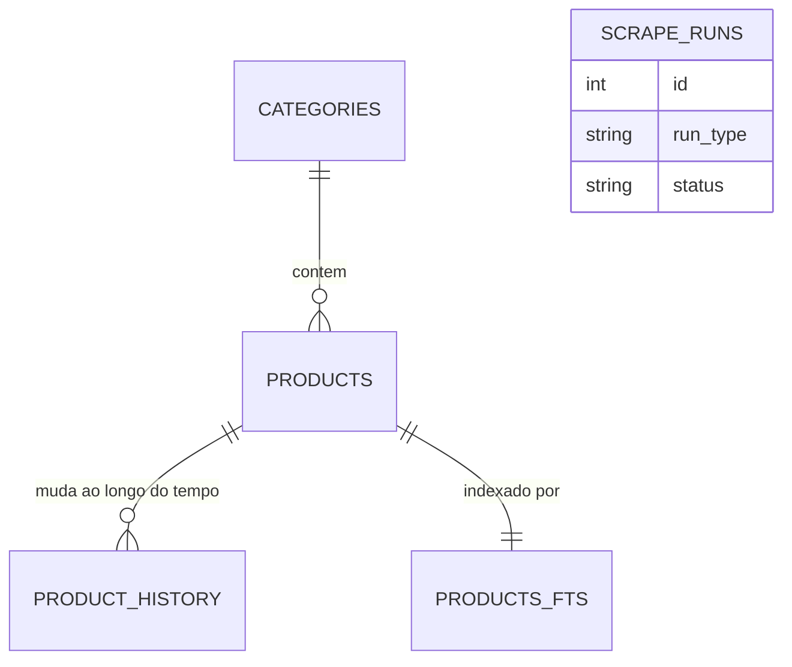

# Modelo de dados

SQLite (WAL) via SQLModel. Definido em `app/models.py`; o índice de texto completo fica em `app/search/fts.py`.

| Tabela | Guarda | Observações |
| --- | --- | --- |
| `categories` | Categorias da loja descobertas pelo sitemap | `id` é um CRC32 estável do caminho da categoria (a loja não expõe id numérico) |
| `products` | O estado atual de cada produto | preço, preço à vista, parcelas (JSON), tamanhos (JSON), estoque, imagens (JSON), breadcrumbs, marca, status, visualizações |
| `product_history` | Uma linha por **mudança real** de preço, preço à vista, disponibilidade ou status | Alimenta o gráfico de preço e a resposta de histórico do chat |
| `scrape_runs` | Cada atualização completa, incremental ou individual | tipo, contagens de coletados, falhas e desaparecidos, status, erro |
| `products_fts` | Índice FTS5 do SQLite sobre nome, marca, breadcrumbs e slug | Ranking BM25; as descrições ficam de fora de propósito |

O status do produto é `active`, `out_of_stock` ou `disappeared`. Um produto é marcado como desaparecido quando a página dele retorna 404.
