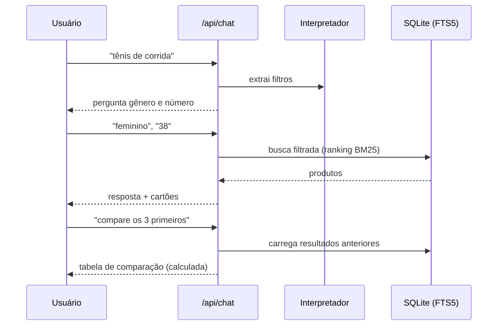

# Como funciona

As decisões que moldam o Garimpo, e por quê.

## Um chat que não inventa nada

O chat é baseado em regras de propósito. Um interpretador transforma português ou inglês em filtros, o banco responde e a resposta é montada a partir das linhas. Pedidos de acompanhamento como *comparar*, *mais barato* e *histórico de preço* atuam sobre os produtos da última resposta.

Todo número que o usuário vê é um valor do banco. Não há modelo para alucinar um preço, nem chave de API ou custo por mensagem.

## Como o scraper é educado

- **Um orçamento para o processo todo**: cerca de 1 requisição por segundo com 500 a 1500 ms de variação, compartilhado por todas as tarefas, então uma atualização completa e uma manual nunca dobram a carga.
- **robots.txt espelhado no código**: caminhos e parâmetros bloqueados geram erro antes de qualquer requisição.
- **Identidade honesta**: user agent `GarimpoBot` com link para o repositório.
- **Recuo progressivo**: respostas 429 e 5xx são repetidas com espera exponencial e depois abandonadas.
- **Somente o mesmo site**: links para outros hosts nunca são seguidos e o proxy de imagens tem lista exata de hosts.
- **Canário**: uma checagem semanal faz cerca de quatro requisições para notar mudanças no HTML cedo.

## Dados frescos sem sobrecarregar a loja

Coleta completa a cada 6 horas, os 200 produtos mais vistos a cada 15 minutos e atualização em segundo plano quando alguém abre um produto com mais de 5 minutos. O histórico de preços só é gravado quando um campo monitorado muda, então a tabela fica pequena e cada linha é uma mudança real.

## Postura de segurança

O HTML coletado e as mensagens do chat são entradas não confiáveis.

- Proxy de imagens: lista exata de hosts, sem IPs, limite de tamanho, verificação do tipo do conteúdo e cada redirecionamento revalidado contra a lista.
- Os endpoints de administração ficam desativados sem token e recusam tokens fracos em produção.
- Limites de taxa no chat e nas imagens, sessões em memória limitadas, CORS estrito, cabeçalhos de segurança.
- O React renderiza as respostas como texto; links e URLs de imagem precisam ser `http(s)` simples.
- Contêiner sem root e somente leitura. CodeQL e Dependabot agrupado rodam no CI.

Detalhes em [Segurança](./security).

## Observabilidade

Coletas, mudanças de produto e erros são eventos JSON estruturados no stdout (`garimpo.run.completed`, `garimpo.product.updated`, `garimpo.error.parse`), então qualquer coletor de logs os usa sem agentes nem dependência de fornecedor.
